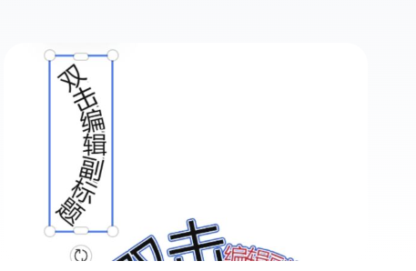

## 需求
实现在leafer中自定义文字效果，可调整文字弧线扭曲排列，可针对文本内部单独设置字体字号颜色阴影等样式，全选文字设置可自动排列文本序号
文字可以弯曲展示，弯曲的时候可以选择部分元素，可以单独设置某一个的字的样式。

## 参考效果



## 小建议
- 要对leaferJs提供的LeaferText元素进行扩建，甚至重写一个LeaferText元素。
- 单独编辑是否可以在触发选中的时候弹出dom元素，dom中使用quill等实现曲线排列。单独设置其中一个字符的样式
- 当然quill没有曲线排列的话，另说，这个思路可以参考
- 通过插件接入

## 需求理解

这是一个独立的曲线富文本画布对象：整段文字沿曲线排布，用户可整体选择、移动和变换，也可进入字符编辑模式选中单个字或连续字符范围，并单独设置字体、字号、颜色、描边、阴影等样式。

首期将“弯曲文字”理解为**字符沿圆弧基线排列**，每个字符随曲线切线旋转；不做字形轮廓本身的扭曲变形。参考图片用于说明可选中对象和编辑文字的方向，不限定最终界面。

字符边界按 Unicode 字素簇处理，避免 emoji 或组合字符被拆开。整个曲线文字仍是一个业务对象；内部字符选择和样式编辑由插件对象管理。

## 首期功能范围

- 输入和修改文字；设置整体默认样式。
- 设置弯曲角度和弯曲方向。方向至少支持顺时针/逆时针，并提供直观预览；角度为 0 时文字恢复直线排布。
- 设置圆弧半径、起始角度、对齐方式和字符间距。角度控制整体弯曲程度，半径控制曲率，两者语义分别明确。
- 字体允许用户自定义；宿主负责加载/注册字体，插件测量接口必须使用当前字素簇实际生效的字体样式，字体未就绪时不得把 fallback 测量结果当最终布局。
- 点击定位字符、拖动选择连续字符范围、全选和取消选择；对所选字符应用样式。
- 整体对象可被画布选择、移动、旋转和缩放。
- 保存/加载、撤销/重做、缩略图及预览正确保留文字、曲线参数和局部样式。

首期不做任意贝塞尔曲线、闭合路径排字、字形轮廓扭曲、非连续多段选择、复杂段落排版、逐字动画和完整双向文字排版。

## 插件方案

新增独立包 `packages/leafer-x-curved-text`，对外提供可加入 Leafer 场景的独立对象（例如基于 `Group` 组合实现的 `CurvedText`）。插件负责排版、字符子对象、指针命中、字符范围选择和事件；宿主负责文档状态、工具栏、属性面板、保存及撤销历史。

插件遵守仓库约定：不引入 React/Vue/store，只依赖 `@leafer-ui/core` 和 `@leafer-ui/interface`，并与 Leafer 2.2.3 共用同一 core。插件实例属于运行时对象，**不能序列化进作品**。

API 草案（名称需在验证 Leafer 2.2.3 的 Group/事件/命中行为后确定）：

```ts
const object = new CurvedText({ text, layout, defaultStyle, styleRuns });
object.setText(text);
object.setLayout(layout);
object.setStyles(defaultStyle, styleRuns);
object.setCharacterSelection({ start, end });
object.clearCharacterSelection();
object.on("character-selection-change", ({ start, end }) => {});
object.destroy();
```

字符编辑模式与普通对象选择/变换模式要显式切换，避免拖选字符时误拖画布对象。DOM 编辑层由宿主 React 提供；Quill 可作为富文本编辑模型候选，但不是曲线排版引擎，也不应直接作为最终画布渲染结果。

## 可序列化数据草案

```ts
type CurvedTextData = {
  id: string;
  kind: "curvedText";
  x: number;
  y: number;
  rotation: number;
  text: string;
  layout: {
    type: "arc";
    bendAngle: number;
    direction: "clockwise" | "counterclockwise";
    radius: number;
    startAngle: number;
    align: "start" | "center" | "end";
    letterSpacing: number;
  };
  defaultStyle: CurvedTextStyle;
  styleRuns: Array<{ start: number; end: number; style: Partial<CurvedTextStyle> }>;
};
```

`styleRuns` 范围按字素簇索引，以 `[start, end)` 表示。角度单位统一使用度；`direction` 决定弧线向上/向下或顺/逆时针的实际呈现约定，Demo 中需明确可视反馈。编辑文字后需裁剪或调整样式范围；首期采用可测试的范围更新规则，必要时再改为稳定字符 ID。

## 排版与渲染思路

1. 将文字切分为 Unicode 字素簇（包含 emoji ZWJ、肤色、旗帜、变体选择符和键帽序列），按对应字体和样式测量 advance width。
2. 根据总字宽、弯曲角度、半径、方向、起始角和对齐方式计算每个字素簇的位置。
3. 将字符中心放到圆弧上，并沿局部切线旋转；每个字符使用独立样式。
4. 字符子对象位于插件对象的局部坐标系中；对象整体变换继续由宿主画布处理。
5. 文字、样式或弧线参数变化时更新排版。初版可全量重排，测得性能问题后再做局部缓存。
6. 主画布使用插件对象；缩略图 worker 使用共享的纯布局算法和 Canvas 2D 绘制，不创建 DOM、React 或 Leafer 交互对象。

逐字子对象对中文和常见拉丁字符较直接，但复杂脚本、连字、双向文字、字体 kerning 和 emoji 字体度量可能与整段 Text 有差异。P0 必须验证并记录首期支持范围，不能假设逐字拆分天然等价于浏览器整段排版。用户自定义字体由宿主加载；测量前等待字体 ready，字体加载完成或更换后重新布局。作品是否嵌入字体及其授权由产品另行定义。

## 项目接入点

- `src/types/elementNode`：新增曲线文字节点和样式/布局类型，`kind` 放在具体接口。
- `canvasStore`：新增创建、更新、范围样式更新等可撤销操作。
- `leaferCanvas/ui`、`tree/syncNodeTree.ts`：按业务数据创建、增量更新和释放插件对象，不调用 `app.tree.clear()`。
- 属性面板/字符工具栏：整体布局参数与字符范围样式分开；无字符选区时编辑默认样式，有选区时编辑该范围。
- 文本编辑事件：普通 Leafer Text 当前关闭编辑器后只回写整段文本；曲线文字需独立字符选择和编辑流程，不能直接复用为完整方案。
- 缩略图 renderer：使用共享纯函数计算字符位置并绘制，覆盖样式和角度。
- 保存加载、复制页面、撤销重做、预览只读模式均需覆盖新节点。

## 实施计划

### P0：插件技术验证

- 在 Leafer 2.2.3 下验证独立 Group 对象的创建、整体变换、子对象更新、命中和销毁。
- 实现纯函数：字素簇分割、字符测量接口、圆弧布局；覆盖空串、单字、混合字号、标点、空格和复杂 Unicode。
- 制作纯 HTML Demo：输入文字，调节弯曲角度、弯曲方向、半径、起始角和字距，验证整体变换与字符位置。
- 确认角度与方向的交互定义、字体度量限制及插件 API。

### P1：插件对象能力

- 定稿序列化输入类型、增量更新方法和事件契约。
- 实现字符命中、连续范围选择、选区反馈和范围样式覆盖。
- 补齐插件 README、纯 HTML Demo、Vitest/jsdom 单测和类型构建。

### P2：接入 Paint Canvas

- 增加节点模型、素材入口、整体属性面板和字符编辑工具栏。
- 接入 store 历史、后端作品保存/加载、页面复制和只读预览。
- 主画布和缩略图共用布局算法，补充 worker 绘制测试。
- 验证创建、编辑字符、改样式、保存重载、撤销重做、缩略图和预览完整流程。

### P3：扩展

- 根据使用反馈评估任意路径、更多文字塑形、非连续范围、自动编号、逐字动画和文字方向支持。
- 根据性能基准决定是否优化局部排版缓存。

## 验收标准

- 可设置弯曲角度和弯曲方向，界面变化与保存后重载一致；角度归零可恢复直线排布。
- 曲线文字作为一个对象能整体选择、移动、旋转和缩放。
- 字符编辑模式下能选中单字及连续范围，选区可见，操作不会误触发对象拖拽。
- 对范围设置字体/字号/颜色/描边/阴影只影响所选字符；默认样式仍可独立修改。
- 主画布、缩略图、预览和保存重载结果一致；修改进入正确的撤销/重做历史。
- 节点销毁后插件释放子 UI 和监听，不留下场景对象。
- 插件测试覆盖排版输入边界、弯曲角度/方向、范围选择和样式更新。

## 待确认问题

1. 原始描述中的“自动排列文本序号”是指自动均匀排字/字距，还是给字符添加数字编号？首期暂按可调字距和圆弧对齐理解，不默认实现编号。
2. 弯曲角度的交互范围和零度基准是否采用 `-180°` 到 `180°`？建议首期用角度数值控件加方向切换，并限制单行圆弧不超过一整圈。
3. 方向是否用“顺时针/逆时针”，还是老师更容易理解的“向上弯/向下弯”？实现可保留内部方向枚举，界面文案再由原型验证。
4. 阴影是否要求对每个字符单独不同，还是所选范围统一设置？数据模型支持范围覆盖，首期 UI 建议统一应用到选择范围。
5. 字体是否仅限系统字体，还是需要上传/嵌入字体？字体加载会影响测量和导出一致性。

